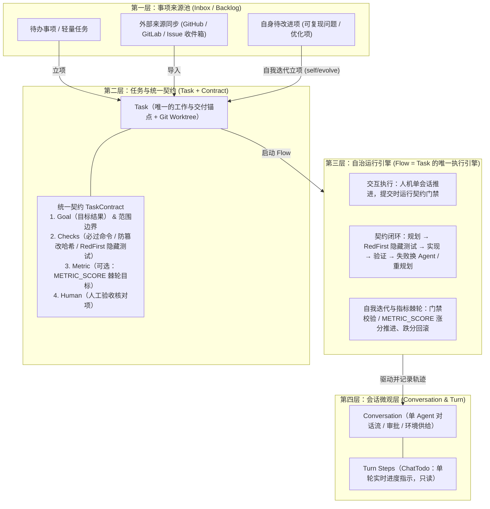

# Conclave 任务 / Flow / 自我迭代 统一领域框架

> 目标：将 Conclave 收敛为**纯粹服务于「任务自主完成（Flow）+ 自我迭代（Evolution / Ratchet）」**的极简架构——清理撞车的双轨冗余、外部 Agent 调用侧尾巴、Conclave 托管浏览器，以及偏离核心目标的多人协作/小队/群聊等外围功能。

---

## 1. 已完成的架构瘦身与清理清单

围绕“单主线自治闭环 + 零额外提示词干扰”，已完成以下五大模块的彻底清理：

### 1.1 撞车的双轨冗余（全部清理）
- **独立 `Ideas` 五列看板**：已移除 Core 端 `IdeaStore` 及 Web 端 `IdeasView` / `SidebarIdeas`，避免与 `TaskBoard` 形成双看板割裂。
- **外部裸跑脚本与重复编排**：已移除 `scripts/self-evolve.mjs`、`scripts/self-friction.mjs`、`scripts/run-autonomous-ratchet.mjs` 及对应 `package.json` 脚本入口；仅保留纯门禁校验脚本 [`self-smoke.mjs`](file:///home/swrd/workspace/conclave/scripts/self-smoke.mjs) 与 [`self-test-policy.mjs`](file:///home/swrd/workspace/conclave/scripts/self-test-policy.mjs) 供自治验证调用。
- **第一代任务执行旧轨 UI**：已移除 `TaskPlanCard` 与 `TaskRunPanel`；在 [`TaskDetail.tsx`](file:///home/swrd/workspace/conclave/packages/web/src/components/TaskDetail.tsx)、[`TaskActions.tsx`](file:///home/swrd/workspace/conclave/packages/web/src/components/TaskActions.tsx) 与 [`TaskLaunchDialog.tsx`](file:///home/swrd/workspace/conclave/packages/web/src/components/TaskLaunchDialog.tsx) 中将任务执行主入口统一收口至 `Flow`。

### 1.2 Agent 调用侧尾巴与 Conclave 浏览器体系（全部清理）
- **Agent CLI 启动参数净化**：
  - [`codex-app-server.ts`](file:///home/swrd/workspace/conclave/packages/core/src/agents/codex/codex-app-server.ts)：已移除默认塞入 `-c features.<key>=false` 禁用 Codex 原生浏览器的逻辑，完全交还 Agent 原生能力。
  - [`claude-stream-json.ts`](file:///home/swrd/workspace/conclave/packages/core/src/agents/claude/claude-stream-json.ts)：已移除 `--chrome` / `--no-chrome` 注入。
  - [`chat-settings.ts`](file:///home/swrd/workspace/conclave/packages/core/src/chat-settings.ts)、[`conversation-service.ts`](file:///home/swrd/workspace/conclave/packages/core/src/conversation-service.ts)：已移除会话待办注入（`USER_TODO_NOTE`）、管理类 MCP 工具、完成汇报提示词（`REPORTING_INSTRUCTION`）及浏览器偏好开关，默认关闭 `promptSuggestions`。
- **Conclave 托管浏览器与书签**：Web 端本身不提供内嵌浏览器宿主，已全面移除 Core 端 `BrowserService`、`BookmarkStore`、`mcp-browser-tools` 以及 Web 端 `BrowserPanel`、`BookmarkSettings` 等全部浏览器相关模块。
- **Conclave 注入的 MCP 工具集极简化**：[`mcp-server.ts`](file:///home/swrd/workspace/conclave/packages/core/src/mcp-server.ts) 与 [`agent-command.ts`](file:///home/swrd/workspace/conclave/packages/core/src/agent-command.ts) 仅保留最小必要工具：
  - `show_preview`（本地预览卡片）
  - `terminal_run` / `terminal_read` / `terminal_stop`（受控终端执行与读取）
  - `history_list` / `history_read`（按需开启的跨会话与任务只读历史检索）

### 1.3 偏离核心目标的外围功能（全部清理）
- **会话右侧待办栏（`TodoPanel` / `TodoStore` / `mcp-todo-tools`）**：已清理。Agent 单轮内部步骤仅保留只读的 [`ChatTodo`](file:///home/swrd/workspace/conclave/packages/protocol/src/chat.ts#L127-L133)（回合步骤条）。
- **会话旁路小助手（`HelperPanel`）**：已清理。
- **多 Agent 小队（`Squads`）与子代理委派（`AgentProfiles` / `AgentCalls` / `Delegation`）**：已清理 Core 服务、存储、提示词、MCP 派单工具与 Web 端全部配置页、卡片和状态。
- **多 Agent 群聊与辩论（`Discussions`）**：已清理 Core `DiscussionService`、群聊提示词、历史工具群聊分支以及 Web 端群聊视图、并发提问/辩论草稿模式与侧边栏分组。

---

## 2. 四层极简领域框架

参考 Mirasim 将概念严格切分为 `Agenda（事项） / Goal（目标契约与编排） / Session（会话与单轮进度）` 的分层方式，Conclave 收敛为以下**互不重叠的四层模型**：

### 2.1 核心概念职责边界

1. **`Task`（统一的事项与交付单元）**
   - 统一承载待办事项（零仓库时作为轻量 Backlog 记入看板，显示 `待关联项目` 标识）与绑定仓库后的正式交付任务（独立 Git Worktree、分支与生命周期状态 `pending → running → review → done`）。
   - `Task.details` 专注编写**任务说明**（背景上下文、实现思路、参考文件），不再与验收字段重复。
2. **`TaskContract`（唯一验收规格与指标棘轮）**
   - 定义在 [`contract.ts`](file:///home/swrd/workspace/conclave/packages/protocol/src/contract.ts) 与 [`TaskContractPanel.tsx`](file:///home/swrd/workspace/conclave/packages/web/src/components/TaskContractPanel.tsx)。
   - 包含客观验证命令（`checks` + SHA-256 防篡改校验，首次打开自动读取 `.conclave/project.json` 默认检查命令）、独立只读 Agent 编写的 `RedFirst` 隐藏测试、可选的**指标棘轮（`ratchet`：`maximize` / `minimize` + 目标阈值）**，以及上线前的人工核对清单（`human`）。
3. **`Flow`（唯一自治执行引擎）**
   - 定义在 [`flow-service.ts`](file:///home/swrd/workspace/conclave/packages/core/src/flow-service.ts) 与 [`FlowPanel.tsx`](file:///home/swrd/workspace/conclave/packages/web/src/components/FlowPanel.tsx)。
   - 驱动 `规划 → RedFirst 隐藏测试 → 分步实现 → 门禁验证 → 失败自动重试 / 切换可用 Agent / Replan`。
   - **环境补给总线（`waiting_environment`）**：缺少工具、MCP 服务或环境变量时挂起任务，在 [`FlowPanel.tsx`](file:///home/swrd/workspace/conclave/packages/web/src/components/FlowPanel.tsx) 直接提供 MCP 挂载与检查环境变量（`KEY=VALUE`）注入表单，不破坏契约 `trustedHash` 且不向提示词泄露密钥明文。
   - **指标棘轮（Metric Ratchet）**：检查输出 `METRIC_SCORE=<数值>`（及可选 `GOAL_REACHED=true`）时，自动在任务独立 Worktree 上创建最佳检查点提交；后续轮次若指标退化则自动回滚至最佳检查点，直至达到目标阈值或跑满预算后带着最优提交进入 `review`。
4. **`Evolution`（端到端自我迭代流水线）**
   - 定义在 [`evolution-service.ts`](file:///home/swrd/workspace/conclave/packages/core/src/evolution-service.ts) 与 [`EvolutionDialog.tsx`](file:///home/swrd/workspace/conclave/packages/web/src/components/EvolutionDialog.tsx)（看板顶栏 `自我迭代` 入口）。
   - 将针对 Conclave 自身的可复现改进项转化为标准自治 `Task` + `Flow`，强制绑定五道门禁（`typecheck` · `test` · `build` · [`self-smoke.mjs`](file:///home/swrd/workspace/conclave/scripts/self-smoke.mjs) · [`self-test-policy.mjs`](file:///home/swrd/workspace/conclave/scripts/self-test-policy.mjs)）。Flow 进入 `review` 时自动提交影子 Worktree 并快进推进 `self/evolve` 分支；若暂停或失败则自动将改进项恢复为 `open` 待重试。
5. **`Conversation`（纯净单会话容器）**
   - 用于日常自由探索、外部 Issue 只读调查，或承载 `Task` / `Flow` 的执行对话。
   - 右侧 Inspector（[`TaskInspector.tsx`](file:///home/swrd/workspace/conclave/packages/web/src/components/TaskInspector.tsx)、[`ConversationInspector.tsx`](file:///home/swrd/workspace/conclave/packages/web/src/components/ConversationInspector.tsx)）精简聚焦于：`flow`（自治轨迹）、`changes`（代码变更 Diff）、`branch`（Git 分支提交）、`plan`（方案审阅）及调试开关下的 `wire`。

---

## 3. 已落地的统一闭环能力一览

| 层级 | 核心能力 | 协议与后端实现 | 前端交互入口 |
| :--- | :--- | :--- | :--- |
| **L1 事项层** | 零仓库轻量记事与外部收件箱同池流转 | [`task.ts`](file:///home/swrd/workspace/conclave/packages/protocol/src/task.ts)、[`task-service.ts`](file:///home/swrd/workspace/conclave/packages/core/src/task-service.ts) | [`NewTaskDialog.tsx`](file:///home/swrd/workspace/conclave/packages/web/src/components/NewTaskDialog.tsx)、[`TaskBoard.tsx`](file:///home/swrd/workspace/conclave/packages/web/src/components/TaskBoard.tsx) |
| **L2 契约层** | 任务说明与契约职责解耦、指标棘轮与人工核对项 | [`contract.ts`](file:///home/swrd/workspace/conclave/packages/protocol/src/contract.ts)、[`command-check.ts`](file:///home/swrd/workspace/conclave/packages/core/src/command-check.ts) | [`TaskDetail.tsx`](file:///home/swrd/workspace/conclave/packages/web/src/components/TaskDetail.tsx)、[`TaskContractPanel.tsx`](file:///home/swrd/workspace/conclave/packages/web/src/components/TaskContractPanel.tsx) |
| **L3 自治层** | 默认自治启动、环境补给恢复、棘轮涨分存档与跌分回滚 | [`flow-service.ts`](file:///home/swrd/workspace/conclave/packages/core/src/flow-service.ts)、[`flow-policy.ts`](file:///home/swrd/workspace/conclave/packages/core/src/flow-policy.ts) | [`TaskLaunchDialog.tsx`](file:///home/swrd/workspace/conclave/packages/web/src/components/TaskLaunchDialog.tsx)、[`FlowPanel.tsx`](file:///home/swrd/workspace/conclave/packages/web/src/components/FlowPanel.tsx) |
| **L3 自演进** | 可复现改进项管理、五道门禁验证、自动快进 `self/evolve` | [`evolution-service.ts`](file:///home/swrd/workspace/conclave/packages/core/src/evolution-service.ts) | [`EvolutionDialog.tsx`](file:///home/swrd/workspace/conclave/packages/web/src/components/EvolutionDialog.tsx) |
